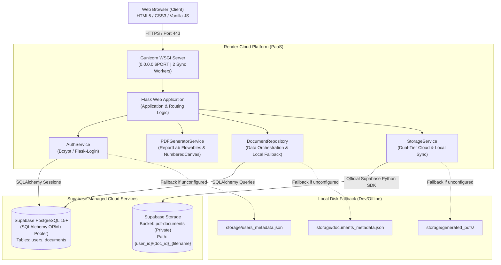
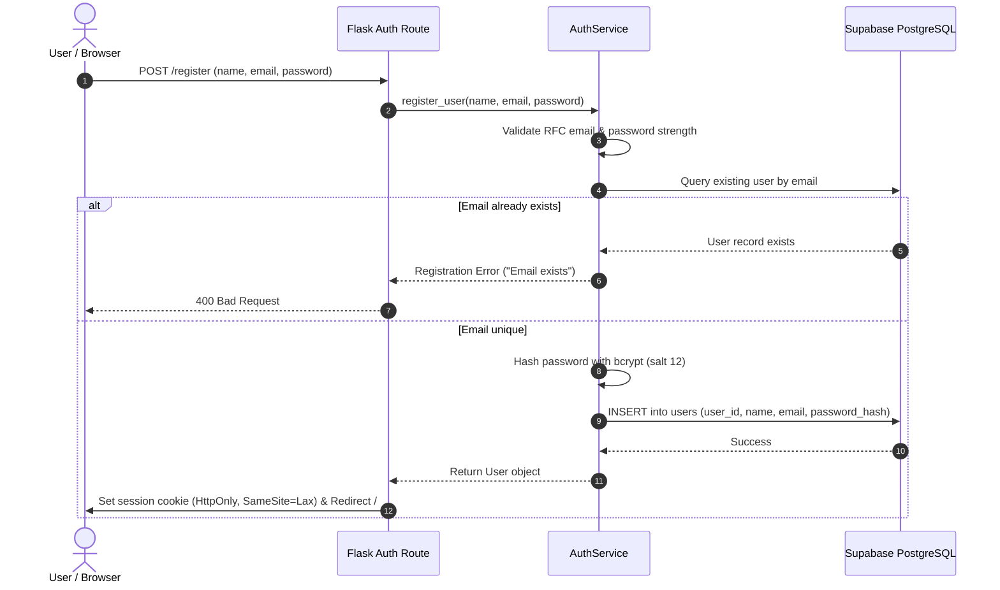
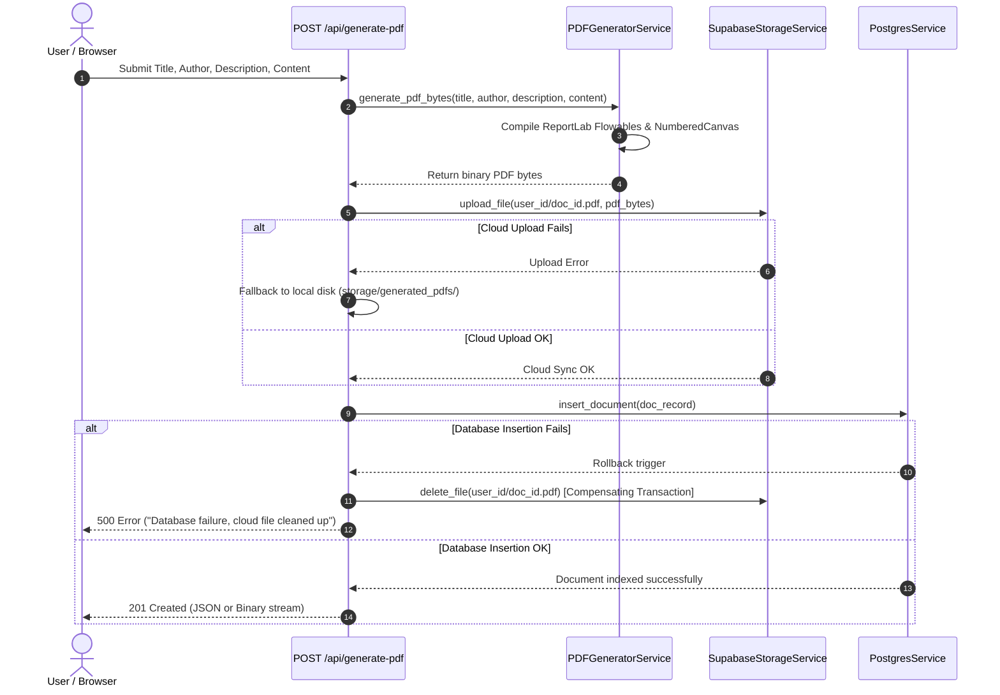
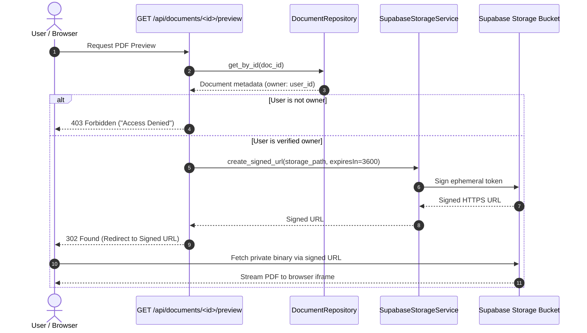
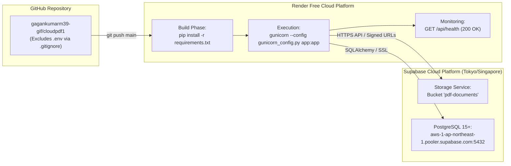

# System Architecture Documentation

## Cloud-Based PDF Generation System — Milestone 12

This document describes the architectural design, component interactions, workflows, and deployment topology of the **Cloud-Based PDF Generation System**.

---

## 1. Overall System Architecture Diagram

---

## 2. Component Descriptions

### 2.1 Presentation Layer (Frontend)
- **UI & Layout**: Responsive blue-and-white dashboard built with pure HTML5 and modern CSS3 (no bulky runtime UI frameworks like React/Angular required).
- **Client Scripting (`static/js/main.js`)**:
  - Handles asynchronous document creation requests via Fetch API.
  - Live character count feedback and title sanitization preview.
  - Interactive modal dialogs for inline PDF previewing (`<iframe>`) and document deletion confirmation.
  - Debounced client-side and server-side document search and sorting.

### 2.2 Application Layer (Backend Flask & Gunicorn)
- **WSGI Server (`gunicorn_config.py`)**: Runs Gunicorn with 2 worker processes and a 120-second timeout, tuned specifically for Render Free tier's 512MB RAM cap.
- **Flask Framework (`app.py`)**:
  - Handles routing, session management, CSRF token validation, and error reporting.
  - Exposes production health check monitoring at `/api/health`.

### 2.3 Business Logic & Processing Services
- **`PDFGeneratorService` (`services/pdf_service.py`)**:
  - Encapsulates ReportLab document assembly using Flowables (`Paragraph`, `Spacer`, `Table`).
  - Utilizes custom `NumberedCanvas` to calculate total pages dynamically on the second rendering pass ("Page X of Y").
  - Produces publication-quality A4 PDF documents in memory (`io.BytesIO`).
- **`StorageService` (`services/storage_service.py`)**:
  - Orchestrates dual-tier storage between Supabase Storage (cloud) and local filesystem fallback.
  - Enforces safe filename sanitization.
- **`SupabaseStorageService` (`services/supabase_storage_service.py`)**:
  - Integrates official `supabase` Python SDK.
  - Manages uploads to private bucket `pdf-documents`.
  - Generates signed URLs with 1-hour expiration for secure inline preview and attachment downloading.
- **`PostgresService` (`services/postgres_service.py`)**:
  - Manages relational data persistence via SQLAlchemy 2.0 ORM.
  - Handles connection pooling (`pool_pre_ping=True`) to maintain persistent database connections to Supabase PgBouncer pooler.
- **`AuthService` (`services/auth_service.py`)**:
  - Implements password hashing via bcrypt (work factor 12).
  - Enforces RFC email format validation and password complexity rules.

---

## 3. Core Interaction Workflows

### 3.1 User Authentication Flow

### 3.2 4-Step PDF Generation Pipeline

### 3.3 Private PDF Preview & Download Flow

---

## 4. Cloud Deployment Architecture

